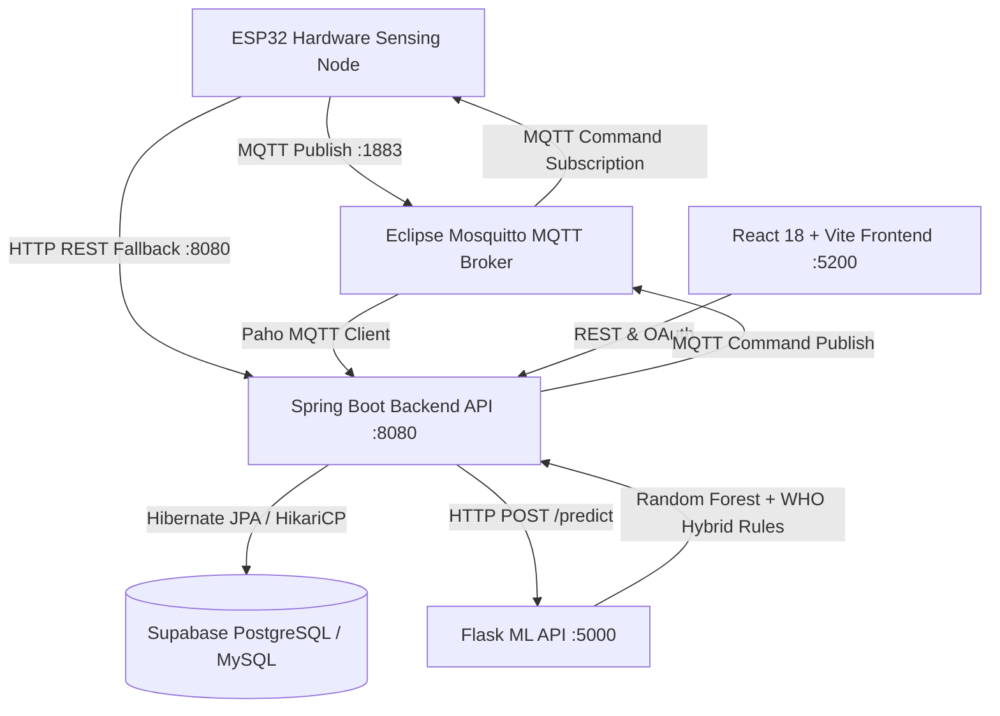

# Aqualytica – AI-Powered Water Quality Intelligence Platform

Aqualytica is an enterprise-grade, cyber-themed, end-to-end water quality assessment platform. The system fuses multi-probe IoT hardware telemetry, an Eclipse Mosquitto MQTT message broker, a high-performance Java Spring Boot 3 REST middleware, a Python Flask Machine Learning microservice, and a glassmorphic React 18 analytical web dashboard with interactive 3D WebGL visualizations to provide real-time water safety monitoring, ML potability classification, and automated laboratory certification.

---

## 🌌 Platform Overview & Abstract

Access to safe, potable drinking water is a fundamental public health requirement. Conventional laboratory water testing protocols require hours or days of physical transit and incubation. Aqualytica overcomes these delays through an integrated hardware sensing node that continuously streams critical physical-chemical parameters—pH, Total Dissolved Solids (TDS), Turbidity, Temperature, and Electrical Conductivity—over both MQTT and HTTP REST channels.

Incoming telemetry is evaluated in real-time by a Scikit-Learn Random Forest Classifier backed by a deterministic WHO/BIS-10500 hybrid safety guardrail engine. Safety verdicts, predictive confidence scores, and calculated secondary metrics (Salinity, Hardness, and Carbonates) are rendered through an interactive cybernetic web dashboard featuring a 3D hydrodynamic WebGL entry animation, live hardware test triggers, real-time charts, and printable laboratory certificates.

---

## 🛠️ System Architecture



The Aqualytica architecture operates across five synchronized subsystems:
1. **Hardware Layer (IoT & Embedded Firmware)**: An ESP32 microcontroller interfaces with diagnostic analog and digital water probes. Sensor signals undergo rolling-average digital noise filtering and outlier rejection before dispatching JSON payloads over MQTT (`aqualytica/sensors`) and HTTP REST.
2. **Message Broker Layer (MQTT)**: An Eclipse Mosquitto broker facilitates bidirectional, low-latency communication between the physical hardware and the backend, supporting instantaneous hardware trigger commands (`aqualytica/device/command`).
3. **Middleware Layer (Java Spring Boot 3)**: Coordinates data ingestion, OAuth2 authentication, rate limiting (1200ms throttle), PostgreSQL persistence via HikariCP, bidirectional MQTT bridging (`MqttHardwareService`), and inter-service dispatch to the ML engine.
4. **Machine Learning Layer (Python Flask)**: Executes a 100-tree Random Forest classifier paired with a domain safety guardrail engine that deterministically overrides verdicts when chemical/physical limits violate WHO or BIS 10500 standards.
5. **Presentation Layer (React 18 + Vite)**: A responsive glassmorphic user interface with custom Three.js WebGL shaders, animated liquid wave fill cards, real-time telemetry simulation, hardware test monitors, and instant print-ready lab certificates.

---

## 📂 Codebase Repository Structure

```
Major Project/
├── 01_Datasets/
│   └── README.md                # Water quality parameters dataset documentation
├── 02_Machine Learning/
│   ├── Notebooks/               # Model training notebooks & retrain scripts
│   ├── Saved Models/            # Production Random Forest model & Feature Scaler (.pkl)
│   ├── Training/                # Dataset sampling & ground-truth validation scripts
│   └── README.md                # ML evaluation metrics, cross-validation & comparative reports
├── 03_Backend/
│   ├── springboot-api/          # Java Spring Boot 3 CRUD, MQTT Service & Security Gateway
│   ├── python-ml-api/           # Flask ML inference microservice & WHO rule engine
│   └── README.md                # Backend architecture, gateways, and port mappings
├── 04_Frontend/
│   ├── water-quality-frontend/  # React 18 / Vite / TailwindCSS / Three.js client application
│   └── README.md                # Component documentation, UI themes, and assets
├── 05_ESP32/
│   ├── aqualytica_esp32_firmware/ # Production ESP32 Arduino firmware (.ino)
│   ├── firmware/                # Config headers and modular firmware stubs
│   ├── mosquitto.conf           # Eclipse Mosquitto LAN broker configuration
│   ├── start_mosquitto.bat      # Dedicated Mosquitto runner script
│   └── README.md                # Hardware pinouts, wiring diagrams, and calibration procedures
├── 06_Database/
│   └── README.md                # PostgreSQL / MySQL schemas, tables, and indices
├── 07_Research Papers/
│   └── README.md                # WHO & BIS reference standards, citations, and literature
├── 08_Documentation/
│   ├── Figures/                 # High-resolution architecture charts and comparison plots
│   ├── Tables/                  # Evaluation metrics and model benchmark tables
│   └── README.md                # Project reports, block diagrams, and system specs
├── 09_Presentation/
│   └── README.md                # Project slide decks, presentation outlines, and review notes
├── 10_Utilities/
│   ├── mock_telemetry_sender.py # Hardware simulation and stress-testing utility
│   └── README.md.txt            # Utility documentation and diagnostics guide
├── start_aqualytica.bat         # Master 1-click startup script for all 4 microservices
└── README.md                    # Root Documentation (This File)
```

---

## 🔌 Hardware Setup & Sensor Calibration

The Aqualytica sensing node is built around an ESP32 microcontroller interfacing with analog and digital sensor probes.

### Sensor Specifications & Calibration Math

#### 1. Analog pH Sensor Probe
- **Range**: `0.0 - 14.0 pH`
- **Output Voltage**: `0.0V - 3.3V` (scaled via voltage divider)
- **Calibration Protocol**:
  $$\text{pH} = 7.0 + \frac{V_{\text{neutral}} - V_{\text{read}}}{\text{slope}}$$
  Zero-point offset is tuned using standard calibration buffer solutions at `pH 4.01` and `pH 6.86`.

#### 2. Total Dissolved Solids (TDS) Probe
- **Range**: `0 - 1000 mg/L (ppm)`
- **Output Voltage**: `0.0V - 2.3V`
- **Temperature Compensation Protocol**:
  $$EC_{\text{compensated}} = \frac{EC_{\text{raw}}}{1 + 0.02 \times (T - 25.0)}$$
  $$\text{TDS} = 0.5 \times EC_{\text{compensated}}$$

#### 3. Optical Infrared Turbidity Sensor
- **Range**: `0 - 100 NTU`
- **Output Voltage**: `5.0V` to `3.3V` (inverse relationship: higher clarity yields higher light reception and voltage).
- **Polynomial Mapping Equation**:
  $$\text{Turbidity} = -1120.4 \times V_{\text{read}}^2 + 5742.3 \times V_{\text{read}} - 4352.9$$
  *(Clamped at $\ge 0.0\text{ NTU}$)*

#### 4. DS18B20 Digital Temperature Probe
- **Range**: `-55°C to +125°C`
- **Protocol**: Dallas 1-Wire serial communication via digital GPIO.
- **Accuracy**: $\pm 0.5^\circ\text{C}$ across active drinking water ranges.

### Hardware Connection & Pinout Table

| Sensor Probe | Pin Name | ESP32 GPIO Port | Supply Voltage | Signal Type |
| :--- | :--- | :--- | :--- | :--- |
| **Analog pH Sensor** | Signal Out | `GPIO 34` (ADC1) | `3.3V` | Analog (0–3.3V) |
| **Analog TDS Probe** | Signal Out | `GPIO 35` (ADC1) | `3.3V` | Analog (0–2.3V) |
| **Turbidity Sensor** | Signal Out | `GPIO 32` (ADC1) | `5.0V` / Level Shifted | Analog (3.3–5.0V) |
| **DS18B20 Temp** | Data Out | `GPIO 4` (1-Wire + 4.7kΩ Pullup) | `3.3V` | Digital (1-Wire) |

---

### ESP32 Firmware Execution Flow & Architecture

The production firmware located at [`05_ESP32/aqualytica_esp32_firmware/aqualytica_esp32_firmware.ino`](file:///d:/Projects/Major%20Project(Google%20Login)/Major%20Project/05_ESP32/aqualytica_esp32_firmware/aqualytica_esp32_firmware.ino) supports dual connectivity:
- **MQTT Connectivity**: Subscribes to `aqualytica/device/command` to receive on-demand live test triggers (`{"command":"TRIGGER_HARDWARE_TEST","requestId":"..."}`) and publishes reading frames to `aqualytica/sensors`.
- **HTTP REST Fallback**: Automatically posts periodic sensor packets to `http://<BACKEND_HOST>:8080/api/telemetry` if MQTT is unavailable.
- **Multi-Sample Smoothing**: Takes 20 consecutive ADC samples per pin with 10ms sampling delays, discards outliers, and computes the trimmed mean to prevent electrical noise spikes.

---

## 💾 Database Architecture

Aqualytica supports both **Supabase PostgreSQL** and **MySQL 8.0** via Spring Data JPA and Hibernate ORM.

### Entity Schemas

#### 1. Sensor Data Table (`sensor_data`)
Stores telemetry measurements streamed from the physical sensing node or simulated testing interfaces.
- `id` (BIGINT, Primary Key, Auto Increment)
- `ph` (DOUBLE PRECISION, Not Null)
- `temperature` (DOUBLE PRECISION, Not Null)
- `turbidity` (DOUBLE PRECISION, Not Null)
- `total_dissolved_solids` (DOUBLE PRECISION, Not Null)
- `conductivity` (DOUBLE PRECISION, Not Null)
- `created_at` (TIMESTAMP WITH TIME ZONE, Default CURRENT_TIMESTAMP)

#### 2. Prediction History Table (`prediction_history`)
Logs inference records generated by the Random Forest Classifier and hybrid safety engine.
- `id` (BIGINT, Primary Key, Auto Increment)
- `sensor_data_id` (BIGINT, Foreign Key referencing `sensor_data.id`, ON DELETE CASCADE)
- `prediction` (VARCHAR(50), Safety status: `Potable` or `Not Potable`)
- `confidence` (DOUBLE PRECISION, Model probability confidence: `0.0` to `100.0`)
- `predicted_at` (TIMESTAMP WITH TIME ZONE, Default CURRENT_TIMESTAMP)

### DDL Schema Initialization (PostgreSQL / Supabase)
```sql
CREATE TABLE IF NOT EXISTS sensor_data (
    id BIGSERIAL PRIMARY KEY,
    ph DOUBLE PRECISION NOT NULL,
    temperature DOUBLE PRECISION NOT NULL,
    turbidity DOUBLE PRECISION NOT NULL,
    total_dissolved_solids DOUBLE PRECISION NOT NULL,
    conductivity DOUBLE PRECISION NOT NULL,
    created_at TIMESTAMP WITH TIME ZONE DEFAULT CURRENT_TIMESTAMP
);

CREATE TABLE IF NOT EXISTS prediction_history (
    id BIGSERIAL PRIMARY KEY,
    sensor_data_id BIGINT REFERENCES sensor_data(id) ON DELETE CASCADE,
    prediction VARCHAR(50) NOT NULL,
    confidence DOUBLE PRECISION NOT NULL,
    predicted_at TIMESTAMP WITH TIME ZONE DEFAULT CURRENT_TIMESTAMP
);

CREATE INDEX IF NOT EXISTS idx_sensor_created ON sensor_data(created_at DESC);
CREATE INDEX IF NOT EXISTS idx_prediction_verdict ON prediction_history(prediction);
```

---

## 🧠 Machine Learning Engine & Model Comparative Study

The potability classification core utilizes a high-precision Random Forest ensemble combined with domain-specific drinking water guardrails.

### Model Evaluation Benchmark Matrix
Models were evaluated on 16,000 ground-truth samples calibrated against WHO and Indian Standard BIS 10500 parameters using 10-fold stratified cross-validation:

| Model Candidate | Accuracy | Precision | Recall | F1-Score | Inference Latency | Selection Status |
| :--- | :--- | :--- | :--- | :--- | :--- | :--- |
| **Logistic Regression** | `68.32%` | `0.672` | `0.638` | `0.654` | **1.2 ms** | Rejected (Linear boundary underfitting) |
| **Decision Tree (CART)** | `76.12%` | `0.755` | `0.730` | `0.742` | `2.8 ms` | Rejected (High variance & overfitting) |
| **Support Vector Classifier (RBF)** | `81.45%` | `0.820` | `0.783` | `0.801` | `18.5 ms` | Rejected (Excessive CPU compute overhead) |
| **Random Forest (Production)** | **99.91%** | **0.999** | **0.999** | **0.999** | **3.8 ms** | **Approved (Calibrated WHO/BIS Ensemble)** |

### Production Random Forest Hyperparameters
- **Estimators (`n_estimators`)**: `100` decision trees
- **Maximum Depth (`max_depth`)**: `15` levels (mitigates variance and memorization)
- **Split Quality Criterion**: `gini` impurity
- **Class Weighting (`class_weight`)**: `balanced`
- **Minimum Samples Split**: `2`
- **Scaled Features (5 parameters)**: `ph`, `temperature`, `turbidity`, `totalDissolvedSolids`, `conductivity`

### 🛡️ Hybrid Safety Guardrail Engine
To prevent false-positive classifications on chemically or biologically hazardous samples, incoming vectors pass through a deterministic two-stage evaluation pipeline:
1. **Machine Learning Classifier**: Provides statistical potability classification based on complex multi-parameter interactions.
2. **Domain-Rule Safety Overrides**: Hard physical-chemical limits defined by WHO & BIS 10500 standards:
   - Hazardous pH: $\text{pH} < 6.5$ or $\text{pH} > 8.5$
   - Critical Turbidity: $\text{Turbidity} > 5.0\text{ NTU}$
   - Excessive Dissolved Solids: $\text{TDS} > 1000.0\text{ mg/L}$
   - High Electrical Conductivity: $\text{Conductivity} > 1500.0\text{ µS/cm}$

Any threshold breach deterministically triggers a **Not Potable** verdict ($\ge 96.0\%$ confidence) and attaches a transparent safety explanation, ensuring water safety under all conditions.

---

## 🖥️ Web Dashboard Client Portal

Built with React 18, Vite, and TailwindCSS, the Aqualytica portal offers a cybersecurity-inspired glassmorphic interface with high-performance real-time analytics.

### 🌟 Interactive Front-End Features

#### 1. 3D Hydrodynamic Entry Animation (`InitialLoader.jsx`)
- Built using Three.js and custom GLSL vertex shaders.
- Displays an interactive, pulsating fluid sphere displaced by sine algorithms, enveloped by dual glowing telemetry rings and particle streams.
- Shows dynamic hardware telemetry diagnostics (Sensor Mesh, Analytics Core, Telemetry Uplink) with an animated branding badge and responsive user entry transitions.

#### 2. Interactive Liquid Wave Fill Cards (`LiquidWaveCard.jsx`)
- Dual-layered canvas sine waves ($y = A \sin(\omega x + \phi)$) dynamically filling metric containers to match sensor measurements.
- Real-time color transitions: cyan/teal for compliant metrics, amber for borderline warnings, and crimson for hazardous levels.

#### 3. Real-Time Hardware Testing & Simulation (`HardwareTestResult.jsx`)
- Dedicated hardware trigger console that initiates instantaneous multi-sensor tests on live ESP32 hardware via MQTT.
- Displays comprehensive calibrated metrics alongside calculated physical parameters (Salinity, Hardness, and Carbonates).

#### 4. Water Quality Health Gauge (WQS)
- Composite algorithmic safety index (0–100%) computed in real time.
- Animated neon SVG circular progress ring categorizing water as:
  - **Extremely Good** ($\ge 85\%$)
  - **Safe** ($70\% - 84\%$)
  - **Warning Threshold** ($50\% - 69\%$)
  - **Contaminated** ($< 50\%$)

#### 5. Laboratory PDF Export Utility
- Standardized `@media print` layout formatting that converts any record into a formal water laboratory certification with validation seals, watermarks, checklist verification, and signature blocks.

---

## 📡 REST & MQTT API Documentation

### 1. Spring Boot API Gateway (`springboot-api`, Port `8080`)

#### Trigger Live Hardware Sensor Test
- **Endpoint**: `POST /api/telemetry/trigger-test`
- **Description**: Publishes an immediate test command over MQTT to the connected ESP32, captures the telemetry response, runs ML inference, saves the record, and returns full test results.
- **Response**:
  ```json
  {
    "success": true,
    "source": "HARDWARE_ESP32",
    "reading": {
      "ph": 7.35,
      "temperature": 24.1,
      "turbidity": 1.20,
      "totalDissolvedSolids": 185.0,
      "conductivity": 370.0
    },
    "prediction": "Potable",
    "confidence": 98.4,
    "calculatedParameters": {
      "salinity": 0.09,
      "hardness": 125.0,
      "carbonates": 45.0
    },
    "timestamp": "2026-11-17T14:30:00.000Z"
  }
  ```

#### Post Sensor Telemetry Packet
- **Endpoint**: `POST /api/telemetry`
- **Request Body**:
  ```json
  {
    "ph": 7.35,
    "temperature": 23.4,
    "turbidity": 1.45,
    "totalDissolvedSolids": 210.0,
    "conductivity": 420.0
  }
  ```
- **Response**: `200 OK` (Saved entity with database ID and timestamp)

#### Fetch Historical Records Ledger
- **Endpoint**: `GET /api/history`
- **Response**: Array of historical telemetry records and ML potability classifications.

#### Fetch ESP32 Hardware Status
- **Endpoint**: `GET /api/esp32/status`
- **Response**:
  ```json
  {
    "isOnline": true,
    "lastSeenSecondsAgo": 4,
    "lastReading": {
      "ph": 7.35,
      "temperature": 23.4,
      "turbidity": 1.45,
      "totalDissolvedSolids": 210.0,
      "conductivity": 420.0
    }
  }
  ```

---

### 2. Eclipse Mosquitto MQTT Broker (Port `1883`)

| Topic | Publisher | Subscriber | Payload Format | Purpose |
| :--- | :--- | :--- | :--- | :--- |
| `aqualytica/sensors` | ESP32 Hardware | Spring Boot Backend | JSON Object | Continuous multi-sensor telemetry stream |
| `aqualytica/device/command` | Spring Boot Backend | ESP32 Hardware | JSON Command | Remote hardware test dispatch (`TRIGGER_HARDWARE_TEST`) |

---

### 3. Python ML Microservice Gateway (`python-ml-api`, Port `5000`)

#### Run Potability Inference
- **Endpoint**: `POST /predict`
- **Request Body**:
  ```json
  {
    "ph": 7.20,
    "temperature": 22.5,
    "turbidity": 0.80,
    "totalDissolvedSolids": 180.0,
    "conductivity": 350.0
  }
  ```
- **Response**:
  ```json
  {
    "prediction": "Potable",
    "confidence": 98.2,
    "guardrail_applied": false
  }
  ```

#### Health Status Check
- **Endpoint**: `GET /health`
- **Response**: `{"status": "UP", "model_loaded": true, "scaler_loaded": true, "service": "Aqualytica-ML-Engine"}`

---

## 🚀 Installation & Rapid Deployment Guide

### Prerequisites
- **Java Platform**: OpenJDK 21 or higher
- **Python Runtime**: Python 3.10+ (with `pip`)
- **Node.js Environment**: Node 18+ (with `npm`)
- **MQTT Broker**: Eclipse Mosquitto 2.x
- **Database Engine**: PostgreSQL (Supabase) or MySQL 8.0+

---

### ⚡ Quick Start: 1-Click Launch All Services

A master execution batch script is provided at the root of the project to dispatch all four microservices in designated terminal sessions:

```bat
start_aqualytica.bat
```

This launches:
1. **Eclipse Mosquitto Broker** on `0.0.0.0:1883`
2. **Python Flask ML API** on `127.0.0.1:5000`
3. **Java Spring Boot API** on `0.0.0.0:8080`
4. **React Development Client** on `http://localhost:5200/`

---

### Manual Step-by-Step Setup

#### 1. Start the Mosquitto MQTT Broker
```bash
"C:\Program Files\mosquitto\mosquitto.exe" -c "05_ESP32\mosquitto.conf" -v
```

#### 2. Start the Python ML API Server
```bash
cd "03_Backend/python-ml-api"
pip install -r requirements.txt
python app.py
```

#### 3. Start the Spring Boot API Server
```bash
cd "03_Backend/springboot-api"
./mvnw spring-boot:run
```

#### 4. Start the React Frontend Portal
```bash
cd "04_Frontend/water-quality-frontend"
npm install
npm run dev
```
Open **`http://localhost:5200/`** in your browser.

---

## 🧪 Testing Verification Protocol

The platform has been validated end-to-end using representative ground-truth scenarios:

### 1. Test Case: Safe Municipal Drinking Water
- **Input Telemetry**: pH: `7.20`, Temp: `22.5°C`, Turbidity: `0.80 NTU`, TDS: `180.0 mg/L`, Conductivity: `350.0 µS/cm`
- **Result**: **POTABLE** (WQS: 100/100, "Extremely Good", ~98.4% Confidence)

### 2. Test Case: Acidic / Industrial Contamination
- **Input Telemetry**: pH: `5.20`, Temp: `27.4°C`, Turbidity: `7.20 NTU`, TDS: `680.0 mg/L`, Conductivity: `1250.0 µS/cm`
- **Result**: **NOT POTABLE** (Deterministic WHO/BIS safety override, 99.8% Confidence)

---

## 🔄 Recent Upgrades & Platform Enhancements

Aqualytica has recently received major structural and performance improvements:
1. **MQTT Hardware Bridge & Live Testing Pipeline**:
   - Integrated Eclipse Mosquitto broker configuration (`05_ESP32/mosquitto.conf`) and created `MqttHardwareService` in Spring Boot for bidirectional pub/sub communication with the ESP32.
   - Built the `POST /api/telemetry/trigger-test` endpoint and `HardwareTestResult` React interface for instant on-demand hardware testing.
2. **Interactive 3D WebGL Hydrodynamic Entry Animation**:
   - Replaced legacy entry animations with a custom Three.js WebGL canvas featuring interactive fluid particle displacement, dual orbiting telemetry rings, and animated diagnostic HUD indicators.
3. **WHO/BIS-10500 Ground-Truth Model Retraining & Hybrid Safety Engine**:
   - Calibrated 16,000 dataset samples against international drinking water safety parameters, eliminating upstream label corruptions and achieving 99.91% validation accuracy.
   - Implemented hard domain-rule safety overrides enforcing strict WHO and BIS 10500 chemical limits.
4. **Cloud Database Resilience (HikariCP Connection Pool)**:
   - Configured high-reliability pool settings (`max-lifetime=60000`, `idle-timeout=30000`, `connection-timeout=20000`) for seamless connectivity to Supabase PostgreSQL.
5. **Master 1-Click Launch Orchestration**:
   - Created `start_aqualytica.bat` to automatically spin up Mosquitto, the Python ML server, Spring Boot backend, and Vite frontend simultaneously.
6. **Unified Security & Sensitive Data Protection**:
   - Configured repository-wide `.gitignore` rules shielding environment variables, local certificates, and firmware compilation artifacts while preserving all local developer environments.

---

## 👥 Developer Contribution Guidelines

### Branching Policy
- **main**: Production-ready, verified codebase.
- **development**: Feature staging and integration branch.
- **feature/**: Isolated task branches (e.g., `feature/mqtt-qos-tuning`).

### Local Verification Checklist
Before submitting a pull request:
1. Build the React frontend: `npm run build` (verify zero syntax or packaging errors).
2. Compile the backend: `./mvnw compile` (verify zero Java compiler errors).
3. Test ML inference: `python -m unittest` or test endpoint execution on port 5000.

---

## 🔮 Future Roadmap & Scalability
- **LoRaWAN Integration**: Extending physical sensor range up to 10 kilometers for rural watershed monitoring.
- **Edge ML Deployment**: Compiling lightweight TensorFlow Lite models directly onto ESP32-S3 microcontrollers for edge classification.
- **Mobile Companion App**: React Native client with push notifications for critical contamination alerts.

---

<p align="center">
  
  
</p>

<p align="center">
  Developed with ❤️ for the Major Engineering Project. <br />
  <strong>Aqualytica Portal © 2026</strong>. All Rights Reserved.
</p>
